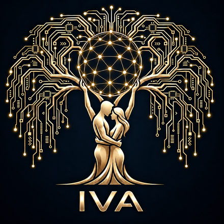

# IVA — AI Engineering & Automation

**Digital systems that take routine off your plate**

Telegram bots · Mini Apps · AI agents · process automation

 

English · Türkçe · Русский — portfolio in <a href="https://7lver10.github.io/iva-portfolio/?lang=en">EN</a> · <a href="https://7lver10.github.io/iva-portfolio/?lang=tr">TR</a> · <a href="https://7lver10.github.io/iva-portfolio/?lang=ru">RU</a>

### What I do

I design and build digital systems around a business goal — from the first conversation to a working product. No noise: a clear architecture, a clean interface, and automation wherever it actually saves time.

- **Telegram bots & Mini Apps** — sales, lead intake, customer service, communities
- **AI agents** — assistants, lead processing, content, analytics
- **Automation** — connected services, CRM, n8n / Make, scheduled reports
- **Websites & catalogues** — fast multilingual storefronts

### Selected work

| Project | What it is |
|---|---|
| [**IVA portfolio**](https://7lver10.github.io/iva-portfolio/?lang=en) | Case studies, approach and ways of working — in English, Turkish and Russian |
| [**FreelanceMatch — demo**](https://7lver10.github.io/freelancematch-demo/) | “Tinder for freelancing” in Telegram: swipe, match, chat, deal, review |
| [**Yakamoz Glass Works — catalogue**](https://7lver10.github.io/yakamoz-catalog/) | Interactive product catalogue in four languages: TR / EN / RU / AR |

### How to start

1. Message me on Telegram — [@iva7lver](https://t.me/iva7lver) (English, Turkish or Russian)
2. Or request a free audit of your process — [@ivavit_bot](https://t.me/ivavit_bot?start=audit)
3. News and breakdowns — in the [I.V.A](https://t.me/I_V_A_A_V_I) channel

IVA · AI Engineering & Automation

